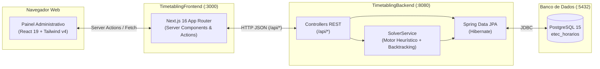
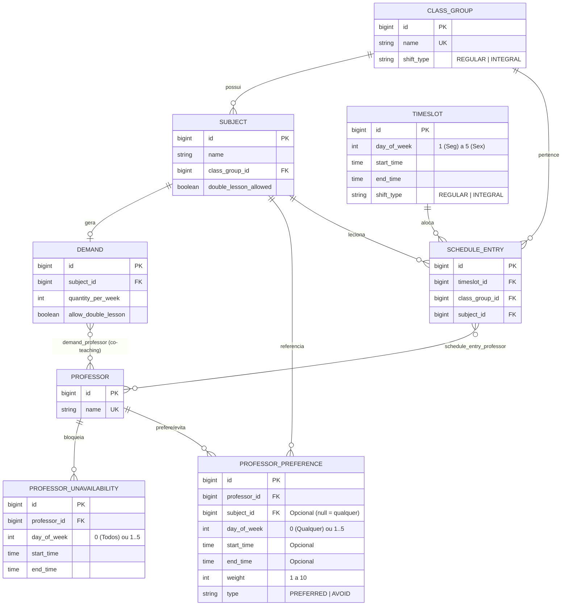

# Arquitetura do Sistema — EtecFlow (ETEC Timetabling)

O **EtecFlow** é um sistema completo de geração e otimização automatizada de grades horárias escolares (*School Timetabling Problem*), projetado especificamente para resolver a complexidade de turnos sobrepostos (**Ensino Regular** vs. **Ensino Técnico Integrado M-Tec/AMS**), aulas duplas (geminadas), co-teaching (múltiplos professores na mesma disciplina), restrições de indisponibilidade e preferências ponderadas de docentes.

---

## 1. Visão Geral dos Componentes



---

## 2. Modelo de Dados (DER)



---

## 3. Estrutura de Diretórios

```text
TimetablingProblem/
├── docker-compose.yaml          # Orquestração PostgreSQL + Backend + Frontend
├── README.md                    # Visão geral e guia rápido
├── docs/                        # Documentação técnica do projeto
│   ├── ARCHITECTURE.md          # Arquitetura, diagramas e modelo de dados
│   ├── API.md                   # Referência de endpoints REST
│   ├── SOLVER.md                # Funcionamento detalhado do algoritmo Solver
│   ├── DEVELOPMENT.md           # Guia de desenvolvimento, seeds e testes
│   └── reference/               # Matriz curricular oficial da ETEC e especificação original
│       ├── curriculum-matrix.txt
│       └── problem.json
├── scripts/                     # Scripts de automação e carga de dados (seeds)
│   ├── start.sh                 # Inicialização completa no Linux/macOS
│   ├── stop.sh                  # Parada de containers no Linux/macOS
│   ├── start.ps1 / start.bat    # Inicialização no Windows (PowerShell / CMD)
│   ├── stop.ps1 / stop.bat      # Parada no Windows (PowerShell / CMD)
│   ├── seed-simple.js           # Seed reduzido (2 turmas) para testes rápidos
│   ├── seed.js                  # Seed intermediário (11 turmas)
│   └── seed_full.js             # Seed completo fiel à matriz curricular oficial (12 turmas, 33 profs)
├── TimetablingBackend/          # API REST e Solver em Java 21 + Spring Boot 4
│   ├── pom.xml
│   └── src/
│       ├── main/java/com/etec/timetabling/
│       │   ├── config/          # Configuração de CORS (WebConfig)
│       │   ├── domain/          # Entidades JPA e Enums
│       │   ├── repository/      # Interfaces Spring Data JPA
│       │   ├── service/         # SolverService (Motor de alocação e otimização)
│       │   └── web/             # Controllers REST
│       └── test/                # Testes automatizados de integração (JUnit 5 + H2)
└── TimetablingFrontend/         # Aplicação Web em Next.js 16 + React 19 + TypeScript
    ├── package.json
    └── src/
        ├── app/                 # Rotas App Router, Server Actions e estilos globais
        ├── components/          # Dashboard interativo (Modais nativos <dialog>, Tabelas, PDF)
        ├── services/            # Cliente HTTP SSR
        └── types/               # Contratos TypeScript compartilhados
```
