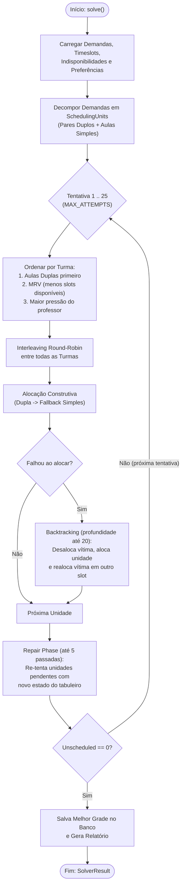

# Motor de Otimização (Solver) — Funcionamento Técnico

O motor de geração de grade horária (`SolverService.java`) resolve o problema de *School Timetabling* combinando heurísticas construtivas, busca local com **backtracking**, **fase de reparo (Repair Phase)** e **múltiplas tentativas estocásticas (Multi-Start)**.

---

## 1. Regras de Negócio e Restrições

### Restrições Rígidas (Hard Constraints)
Nenhuma aula é alocada violando estas regras:
1. **Conflito de Turma:** Uma turma não pode ter duas aulas em intervalos de tempo sobrepostos no mesmo dia.
2. **Conflito de Professor (e Co-Teaching):** Nenhum dos professores associados a uma demanda pode estar lecionando em outra turma (seja do turno `REGULAR` ou `INTEGRAL`) em qualquer intervalo de tempo que tenha interseção (`startTime < otherEnd && endTime > otherStart`).
3. **Sobreposição de Turnos (Regular vs. Integral):**
   - Manhã comum (`08:00` às `12:30`): `REGULAR` e `INTEGRAL` compartilham as mesmas faixas de horário, portanto um professor alocado no `INTEGRAL` às `08:00` está automaticamente bloqueado no `REGULAR` às `08:00`.
   - Horário de Almoço (`12:30` às `13:20`): Exclusivo para a 6ª aula do turno `REGULAR` (enquanto o `INTEGRAL` está em intervalo de almoço).
   - Tarde (`13:30` às `16:00`): Exclusivo para o turno `INTEGRAL`.
4. **Indisponibilidade do Professor (`ProfessorUnavailability`):** Bloqueia o professor no dia específico (`1..5`) ou em todos os dias úteis (`dayOfWeek = 0`) durante a janela `[startTime, endTime]`.

### Restrições Leves e Pontuação (Soft Constraints)
Cada slot elegível livre de conflitos recebe uma pontuação (`scoreSlot`):
- **Aulas Duplas Geminadas (`+50 pts` por par):** Quando `allowDoubleLesson = true` e `quantityPerWeek >= 2`, o solver prioriza pares de slots consecutivos no mesmo dia (`a.endTime == b.startTime`).
- **Penalidade por repetição de matéria no mesmo dia (`-300 pts` por ocorrência):** Evita concentrar várias aulas da mesma disciplina para a mesma turma em um único dia.
- **Balanceamento diário da turma (`-50 pts` por aula já alocada no dia):** Distribui a carga da turma uniformemente entre segunda e sexta-feira.
- **Adjacência / Redução de Janelas (`+60 pts` para turma, `+40 pts` para professor):** Prioriza horários contíguos a aulas já existentes no mesmo dia.
- **Compactação de dias do professor (`+30 pts` se já leciona no dia, `-80 pts` se já possui 6+ aulas no dia):** Evita deslocamentos desnecessários sem sobrecarregar um único dia.
- **Preferências do Professor (`±50 * weight` pts):**
  - `PREFERRED`: Soma de `+50` (peso 1) até `+500` (peso 10) pontos se o slot corresponder ao dia, horário e matéria desejados.
  - `AVOID`: Subtrai de `-50` a `-500` pontos para evitar o slot indesejado.
- **Jitter Estocástico (`-30` a `+30` pts):** Permite explorar diferentes ótimos locais entre as tentativas.

---

## 2. Fluxo do Algoritmo

